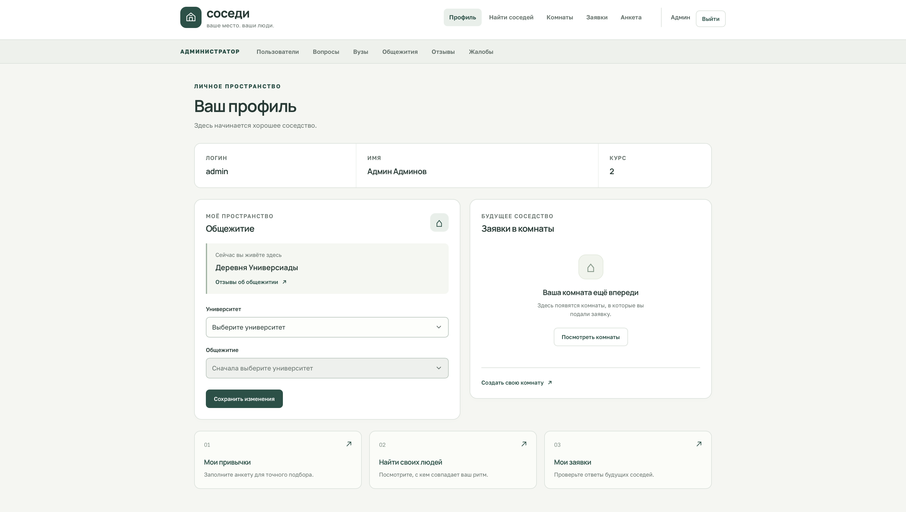
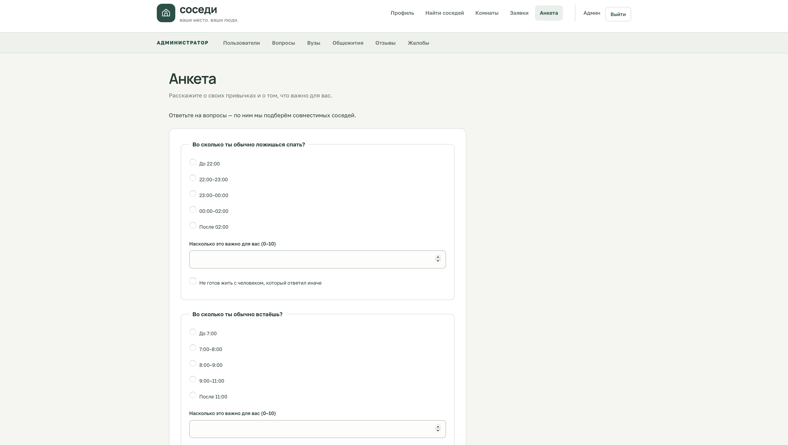
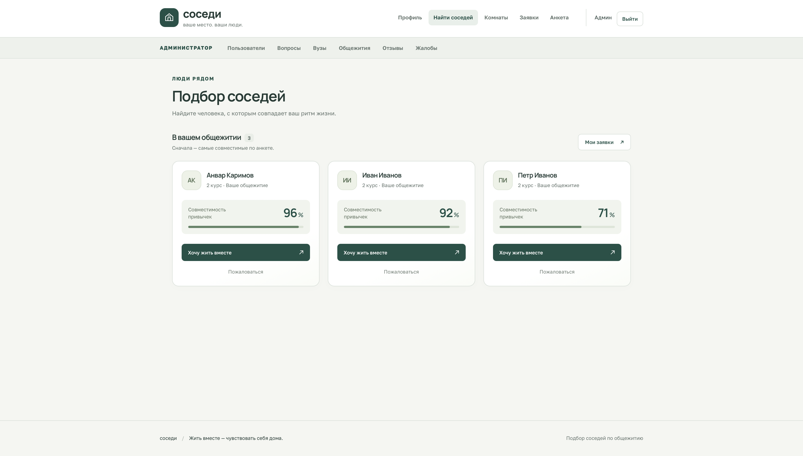
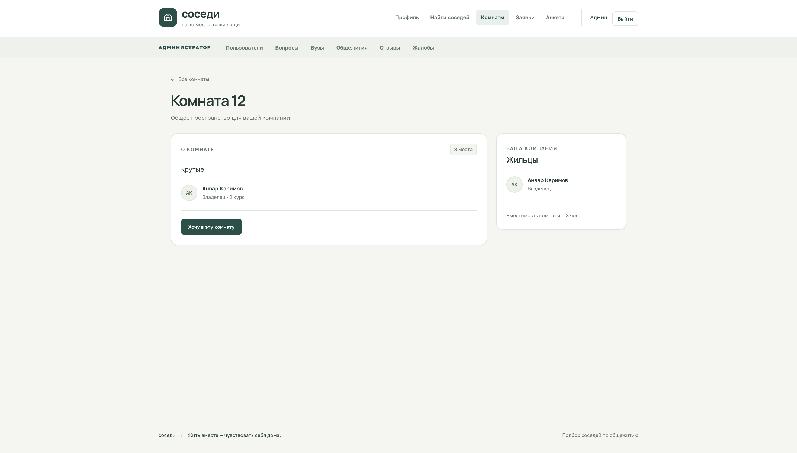
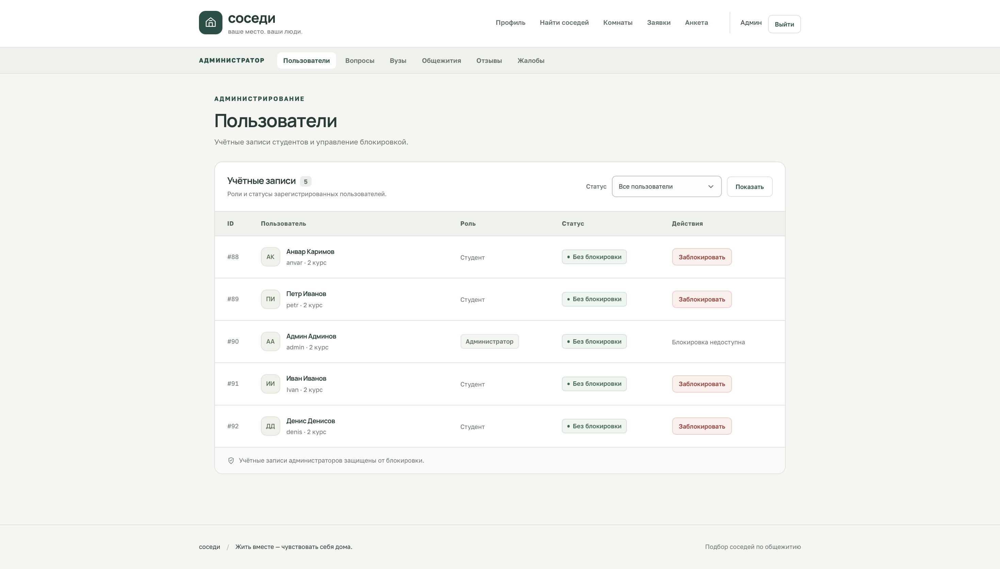

# Roommates

Веб-сервис подбора соседей по общежитию на основе совместимости привычек.

## Зачем нужен проект

Студенты часто выбирают соседей случайно — через чаты и объявления.
Сервис помогает найти подходящих людей в том же общежитии: пользователь заполняет анкету,
указывает важность вопросов и видит кандидатов, отсортированных по проценту совместимости.

## Возможности

- регистрация, вход и подтверждение аккаунта через Telegram-бота;
- профиль с выбором университета и общежития;
- анкета привычек с важностью вопросов и принципиальными условиями;
- подбор соседей с расчётом совместимости и фильтрами;
- заявки на совместное проживание и открытие контактов после принятия;
- создание комнат на 2–4 человека и заявки участников;
- отзывы об общежитиях и жалобы на пользователей;
- административная панель для управления пользователями, вузами, общежитиями, вопросами анкеты и модерацией.

## Стек

- Java 21;
- Jakarta Servlets 6, JSP и JSTL;
- JDBC и PostgreSQL;
- Maven, упаковка WAR;
- Apache Tomcat 11;
- HTML5, CSS3 и JavaScript;
- AJAX через `fetch` и JSON;
- BCrypt для хеширования паролей.

Фреймворки Spring и ORM не используются: бизнес-логика находится в сервисах, работа с базой — в DAO через `PreparedStatement`.

## Архитектура

Проект построен по MVC и разделён на слои:

- сервлеты принимают HTTP-запросы и передают данные в сервисы;
- сервисы содержат бизнес-правила и серверную валидацию;
- DAO выполняют SQL-запросы через JDBC;
- `AppContextListener` создаёт подключения, DAO и сервисы при запуске приложения;
- фильтры отвечают за кодировку, авторизацию и проверку роли администратора;
- JSP используются только как представления с JSTL и Expression Language.

## Связи в базе данных

- `universities` → `dormitories` — связь один-ко-многим: у университета несколько общежитий;
- `dormitories` → `users` — пользователи выбирают общежитие;
- `users` ↔ `questions` через `user_answers` — связь многие-ко-многим с ответом, важностью и принципиальностью;
- `users` ↔ `rooms` через `room_members` — участники комнат хранятся в таблице-связке со статусом заявки;
- `users` → `roommate_requests`, `dorm_reviews` и `complaints` — заявки, отзывы и жалобы пользователей.

Схема базы данных находится в [`src/main/resources/schema.sql`](src/main/resources/schema.sql),
демонстрационные данные — в [`src/main/resources/data.sql`](src/main/resources/data.sql).

## Скриншоты

<p>
  
  
</p>
<p>
  
  
</p>
<p>
  
</p>

## Запуск локально

Требования: Java 21, Maven, PostgreSQL и Tomcat 11.

1. Создать базу PostgreSQL.
2. Выполнить `schema.sql`, затем при необходимости `data.sql`.
3. Скопировать `src/main/resources/db.properties.example` в `src/main/resources/db.properties` и указать параметры базы данных.
4. Для подтверждения аккаунтов через Telegram задать переменную окружения `TELEGRAM_BOT_TOKEN`.
5. Собрать приложение:

```bash
mvn clean package
```

6. Разместить `target/roommates.war` в Tomcat 11 и открыть:

```text
http://localhost:8080/roommates/
```
